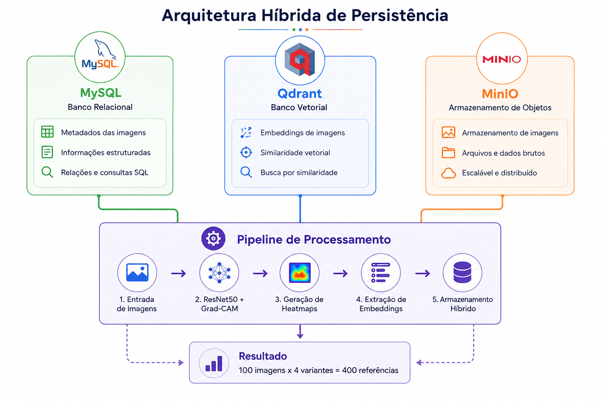
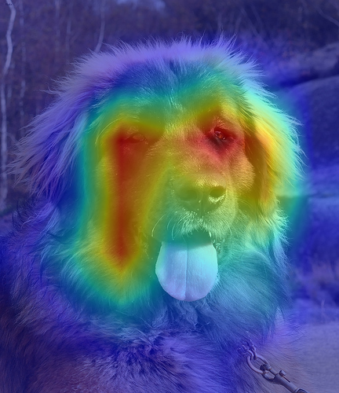
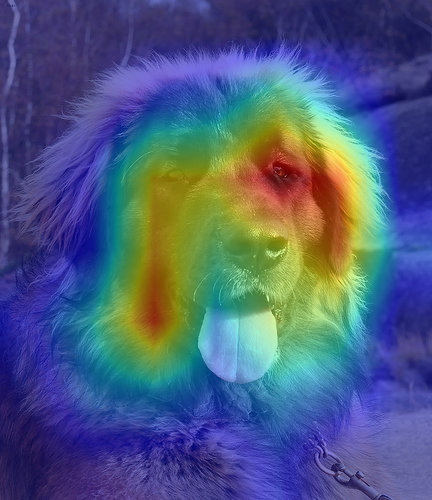
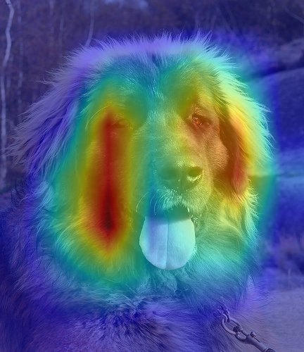

# Persistência Híbrida para Evidências de Explicabilidade (XAI)

[](Artigo_Banco_Dados_Eduardo_Lazaro.pdf)
[](https://www.unesp.br/)
[](#)
[](#)

Repositório científico reunindo a fundamentação teórica, diagramas e rotina de compilação do artigo acadêmico sobre **persistência híbrida e governança de evidências de inteligência artificial explicável (XAI)**, desenvolvido no Programa de Pós-Graduação em Ciência da Computação da **UNESP**.

---

## 📌 1. Proposta Técnica e Arquitetura Tripartite

A proposta unifica três tecnologias complementares para solucionar o descarte de mapas de atenção visual (Grad-CAM):

1. **MySQL 8.0 (Camada Relacional):** Metadados estruturados, parâmetros de inferência, predições, métricas de risco e logs de auditoria ACID.
2. **Qdrant (Camada Vetorial):** Embeddings semânticos de 512 dimensões indexados com grafo HNSW para recuperação top-k por similaridade visual de atenção.
3. **MinIO (Armazenamento de Objetos S3):** Persistência distribuída de imagens brutas em alta resolução e heatmaps Grad-CAM volumosos.

---

## 📊 2. Evidências Visuais e Resultados

| Recurso | Evidência Gráfica |
| :--- | :--- |
| **Arquitetura Tripartite** |  |
| **Grad-CAM Baseline** |  |
| **Grad-CAM sob Ruído** |  |
| **Grad-CAM sob Desfoque** |  |

---

## ⚙️ 3. Compilação do Artigo em PDF

O script de geração utiliza `fpdf2` e fontes do sistema para produzir o PDF formatado nas normas ABNT:

```bash
# Instalar biblioteca
pip install fpdf2

# Compilar artigo
python gerar_artigo_pdf.py
```
O documento será compilado e salvo na raiz como `Artigo_Banco_Dados_Eduardo_Lazaro.pdf`.

---

## 📁 4. Estrutura do Repositório

```text
artigo-bd/
├── assets/                                      # Figuras originais do artigo
├── evidencias/                                  # Evidências e diagramas organizados
│   ├── figure_3.png
│   ├── 02_gradcam_original.png
│   ├── 04_gradcam_gaussian.png
│   └── 06_gradcam_blur.png
├── 01_minha_poroposta.md                        # Delimitação do problema e arquitetura
├── 02_base.md                                   # Metodologia e resultados reportados
├── 03_orientacoes_finais_banco_dados.md         # Diretrizes acadêmicas
├── RELATORIO_CRITICO.md                         # Avaliação crítica e limites
├── gerar_artigo_pdf.py                          # Compilador do artigo em PDF
├── Artigo_Banco_Dados_Eduardo_Lazaro.pdf        # Artigo acadêmico final em PDF
├── Artigo_BD_Relatorio_Publicacao.docx          # Relatório executivo completo em Word
├── APRESENTACAO.md                              # Roteiro de pitch e divulgação
└── README.md                                    # Documentação técnica
```

---

## 📄 5. Material de Publicação para Portfólio

O relatório executivo diagramado em Word, contendo a análise metodológica, tabela completa de latência e benchmark e roteiro editorial para redes profissionais, está disponível em [`Artigo_BD_Relatorio_Publicacao.docx`](file:///d:/projetos/artigo-bd/Artigo_BD_Relatorio_Publicacao.docx).
